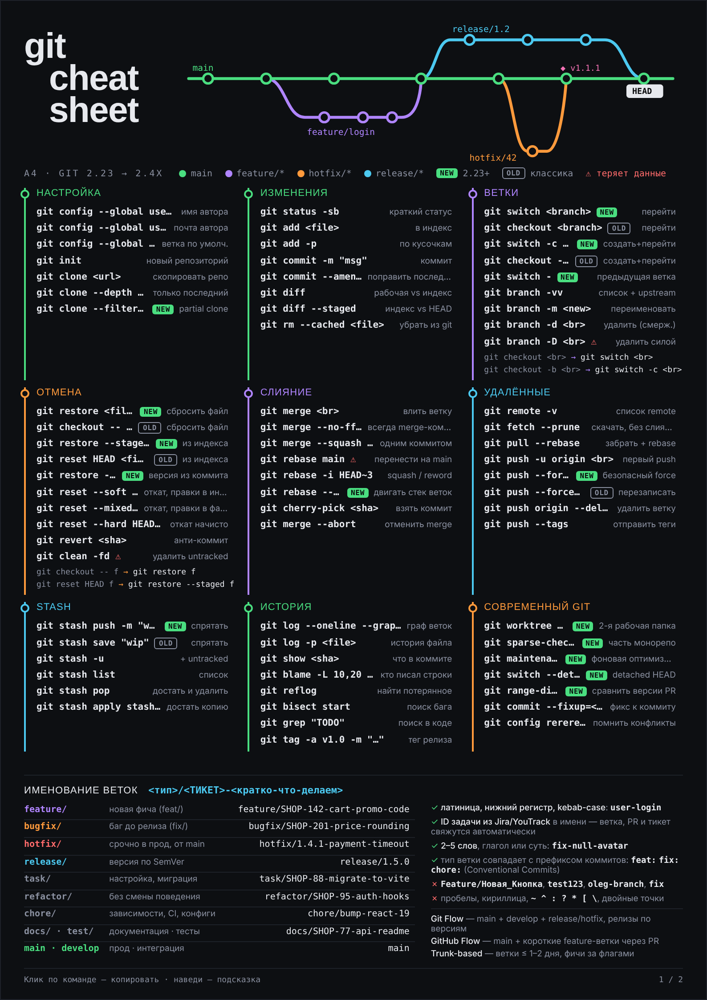

# Git Cheatsheet A4

Интерактивная шпаргалка по Git на двух листах A4 для разработчиков: команды, граф веток, именование веток и Conventional Commits.



**[Демо](https://itsoleggio.github.io/git-cheatsheet-a4/)** · [Макет](docs/screenshot-commits.png)

## Возможности
- **71 команда Git в 9 разделах**, с пометками NEW (Git 2.23+) и OLD и парами «старая → новая»: `checkout` → `switch` / `restore`, `stash save` → `stash push`, `--force` → `--force-with-lease`
- **Подробная подсказка при наведении**: что делает команда, когда применять, полезные флаги, ⚠ для команд, которые теряют данные
- **Копирование в один клик**, фильтр «Все / Новые / Старые» и поиск по командам и описаниям
- **Граф веток в SVG**: при наведении на раздел подсвечивается его ветка, а заголовок «cheat» стоит на одной линии с main
- **Второй лист про коммиты**: формат `type(scope)!: subject`, история в стиле `git log --graph`, связь типов с SemVer, примеры «плохо → хорошо», полное сообщение, CHANGELOG
- **Печать на A4**: два листа ровно по формату, каждый на своей странице, с тёмным фоном

## Стек
Vite · TypeScript (strict) · ванильный DOM без фреймворков · SVG · CSS-файлы по блокам (custom properties, grid, `@page`) · Vitest + jsdom · Playwright · ESLint + Prettier · GitHub Actions → Pages · Google Fonts (Unbounded, IBM Plex Sans, JetBrains Mono)

## Архитектура
```
src/
├── main.ts              # точка входа: собирает листы и вешает обработчики
├── data/
│   ├── commands.ts      # разделы и команды, цвета веток
│   ├── descriptions.ts  # подробные подсказки
│   ├── branches.ts      # типы веток для блока «Именование веток»
│   └── commits.ts       # история для графа, типы коммитов, примеры «плохо → хорошо»
├── model/
│   └── types.ts         # Command, Section, CommitRow, CommitType и другие типы
├── templates/
│   ├── sheet1.html      # статичная разметка листа 1
│   └── sheet2.html      # статичная разметка листа 2
├── render/
│   ├── sheet1.ts        # шаблон листа 1 и таблица веток
│   ├── sheet2.ts        # шаблон листа 2, типы коммитов и примеры
│   ├── branchGraph.ts   # SVG-граф листа 1 и подсветка веток
│   ├── commitLog.ts     # SVG git log --graph листа 2
│   ├── sections.ts      # разделы команд
│   └── titleAlign.ts    # выравнивание «cheat» по линии main
├── features/
│   ├── tooltip.ts       # подробная подсказка при наведении
│   ├── clipboard.ts     # копирование, тост и запасной вариант с выделением
│   └── filter.ts        # фильтр NEW/OLD, поиск, запоминание в localStorage
├── utils/
│   └── dom.ts           # el(), svg(), byId()
└── styles/
    ├── tokens.css       # цвета и шрифты в :root
    ├── base.css         # сброс, панель поиска, подсказка, тост
    ├── sheet.css        # общий каркас листа
    ├── sheet1.css
    ├── sheet2.css
    └── print.css
```
Ключевые решения:
- **Почему без фреймворка**: страница статичная, состояния почти нет: фильтр и строка поиска. Фреймворк увеличил бы бандл, а упростил бы мало. В бандл попадает только свой код.
- **Почему данные отдельно от отрисовки**: тексты проверяются и правятся независимо от SVG и разметки. Чтобы добавить команду, достаточно дописать её в `commands.ts` и `descriptions.ts`, а тесты проверят, что описание на месте и дублей нет.
- **Как держится формат A4**: ширина листа 794 px (A4 при 96 dpi) и `aspect-ratio: 210/297`. В печати `@page { size: A4; margin: 0 }` и размер `210mm × 297mm` дают ровно по одному листу на страницу. На экране контент может сделать лист немного выше, поэтому точный формат задаётся именно в печати. `npm run test:visual` сравнивает оба листа с эталонными скриншотами.

## Запуск
```bash
git clone https://github.com/itsOleggio/git-cheatsheet-a4.git
cd git-cheatsheet-a4
npm install
npm run dev
```

| Скрипт | Что делает |
|---|---|
| `npm run dev` | dev-сервер Vite |
| `npm run build` | проверка типов и сборка в `dist/` |
| `npm run preview` | просмотр сборки |
| `npm run lint` | ESLint |
| `npm run format` | Prettier |
| `npm test` | Vitest |
| `npm run test:visual` | сравнение скриншотов с эталоном; нужен `npx playwright install chromium` |

## Что бы я улучшил
- Английская версия с переключателем языка
- Светлая тема для экономной печати на офисном принтере
- Третий лист: разрешение конфликтов и `rebase -i` по шагам

## Лицензия
MIT
